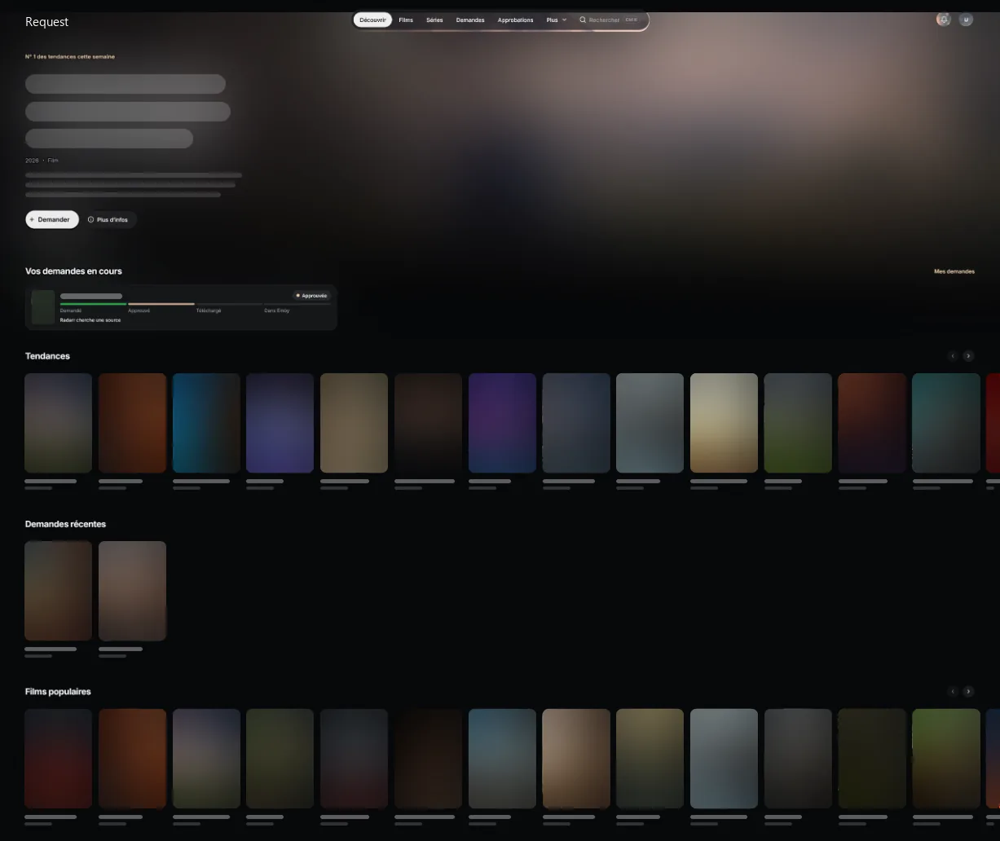
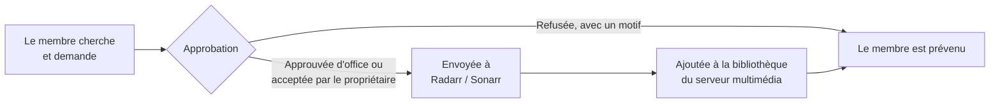

<div align="center">

# Request

**Un portail de demandes pour votre serveur multimédia : on cherche, on demande, on approuve, on regarde.**

[English](README.md) | Français

Request permet à ceux qui partagent votre serveur Emby, Jellyfin ou Plex de demander les films et séries qu'ils
veulent, en deux clics. Vous approuvez, vos outils de bibliothèque font le reste, et chacun est prévenu quand le titre
est prêt à regarder.



</div>

## Points forts

- **Deux clics pour demander.** On choisit un film ou une série, on coche les saisons voulues, et c'est parti. Les
  titres déjà présents sur le serveur sont clairement signalés : personne ne demande deux fois la même chose.
- **Une navigation de plateforme de streaming.** Tendances, populaires, prochainement, ajoutés récemment, par genre
  ou par plateforme, avec une recherche globale (`Ctrl+K`) dans les films, les séries et les personnes.
- **Le contrôle au propriétaire.** Une file d'approbation simple (accepter ou refuser, avec un motif),
  l'approbation automatique pour les membres de confiance, des quotas par membre et quatre rôles : Membre,
  Approbation auto, Gestionnaire et Propriétaire.
- **Toujours savoir où en est une demande.** Chaque demande affiche sa progression, de demandée à approuvée puis
  prête, et la disponibilité se synchronise toute seule avec Radarr, Sonarr et votre serveur multimédia.
- **Des notifications où que l'on soit.** Cloche dans l'appli, courriel, notifications push web et Discord : les
  membres sont prévenus sans avoir à demander.
- **Le compte que l'on a déjà.** Les membres se connectent avec leur compte du serveur multimédia, sans rien créer ni
  retenir de nouveau.
- **S'installe comme une appli, tourne partout.** Un seul conteneur Docker, avec sa base de données intégrée et des
  sauvegardes quotidiennes automatiques. Elle s'installe aussi sur un téléphone comme une application web.

Et au-delà des bases : demandes en 4K, plusieurs serveurs Radarr et Sonarr, signalement de problèmes sur un titre,
liste de souhaits avec import Trakt et Letterboxd, statistiques d'usage, blocage de titres et API publique.

> L'interface est en français.

## Comment ça marche



1. Un membre se connecte avec son compte du serveur multimédia, trouve un film ou une série et le demande.
2. Selon son rôle et son quota, la demande est approuvée tout de suite ou attend dans la file du propriétaire.
3. Une fois approuvée, elle est confiée à Radarr (films) ou Sonarr (séries), qui l'ajoutent à la bibliothèque.
4. Request voit arriver le titre, met à jour son statut partout et prévient le membre.

## Démarrage rapide

Il faut Docker avec Compose v2, un nom de domaine qui pointe vers votre machine, et les ports 80 et 443 joignables
(Caddy s'en sert pour obtenir le certificat HTTPS automatiquement).

```sh
git clone https://github.com/QuentinPN/request.git && cd request
cp .env.example .env              # renseigner DOMAIN
docker compose up -d --build
docker compose logs               # cherchez le jeton d'installation, affiché une seule fois
```

Ouvrez `https://<votre domaine>` : un assistant guide la connexion du serveur multimédia, de Radarr, de Sonarr et de
TMDB, en testant chaque étape en direct. Le premier administrateur du serveur multimédia qui se connecte devient
propriétaire. Réseau local seul, sauvegardes et mises à jour : voir le [guide de déploiement](docs/DEPLOIEMENT.md).

## Stack


## Pour les développeurs

Développement local, tests, organisation du projet et autres documents techniques : voir le
[guide développeur](docs/DEVELOPMENT.md).

## Licence

[MIT](LICENSE)
