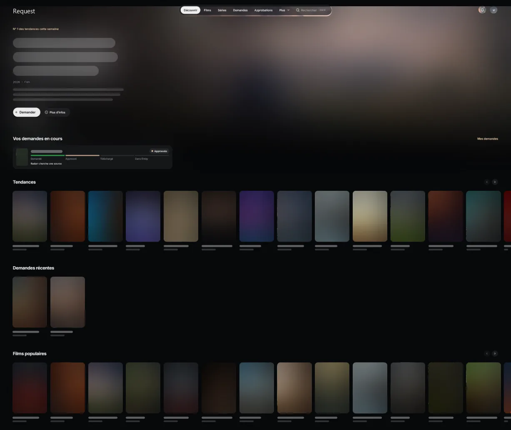
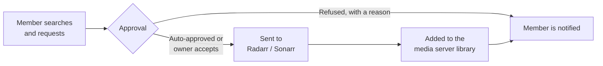

<div align="center">

# Request

**A request portal for your home media server: search, ask, approve, watch.**

English | [Français](README.fr.md)

Request lets the people who share your Emby server (Jellyfin and Plex support is experimental) ask for the films and series they want, in two
clicks. You approve, your library tools take care of the rest, and everyone is told when the title is ready to watch.



</div>

## Highlights

- **Two clicks to ask.** Pick a film or a series, choose the seasons you want, and send. Titles already on the
  server are clearly marked, so nobody asks for the same thing twice.
- **Browse like a streaming app.** Trending, popular, upcoming, recently added, by genre or by streaming platform,
  with a global search (`Ctrl+K`) across films, series and people.
- **Full control for the owner.** A simple approval queue with accept or refuse (with a reason), automatic approval
  for trusted members, per-member quotas, and four roles: Member, Auto-approve, Manager and Owner.
- **Always know where a request stands.** Each request shows its progress from requested to approved to ready, and
  availability is synced automatically with Radarr, Sonarr and your media server.
- **Notified wherever you are.** In-app bell, email, web push and Discord, so members hear back without asking.
- **Sign in with the account you already have.** Members use their media server login, with nothing new to create or
  remember.
- **Installs like an app, runs anywhere.** A single Docker container with a built-in database and automatic daily
  backups. It also installs on a phone as a web app.

More than the basics: 4K requests, several Radarr and Sonarr servers, problem reports on titles, a personal watchlist
with Trakt and Letterboxd import, usage statistics, title blocking, and a public API.

> The interface is currently in French.

## How it works



1. A member signs in with their media server account, finds a film or a series and requests it.
2. Depending on their role and quota, the request is approved on the spot or waits in the owner's queue.
3. Once approved, it is handed to Radarr (films) or Sonarr (series), which put it in the library.
4. Request notices the title has arrived, updates its status everywhere and notifies the member.

## Quick start

You need Docker with Compose v2, a domain name pointing at your machine, and ports 80 and 443 reachable (Caddy uses
them to get the HTTPS certificate automatically).

```sh
git clone https://github.com/QuentinPN/request.git && cd request
cp .env.example .env              # set DOMAIN
docker compose up -d --build
docker compose logs               # look for the one-time setup token
```

Open `https://<your domain>`: a guided setup connects your media server, Radarr, Sonarr and TMDB, testing each step
live. The first media server administrator to sign in becomes the owner. Local-network-only setup, backups and
updates are covered in the [deployment guide](docs/DEPLOIEMENT.md) (in French).

## Built with


## For developers

Local development, tests, project layout and further technical documents are in the
[developer guide](docs/DEVELOPMENT.md) (in French).

## License

[MIT](LICENSE)
