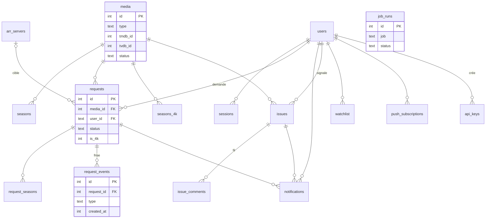

# Modèle de données

SQLite (better-sqlite3 + Drizzle, `casing: 'snake_case'`), un seul processus, WAL, quelques dizaines de membres, quelques milliers de médias. Pas de réglage serveur ni de partitionnement : des tables simples, des index justifiés par un écran ou un job.

## 1. Revue de l'existant (`settings`, `users`, `sessions`)

| Sévérité | Constat                                                                                                                                                                                                                             | Correctif                                                                                                                                                          |
| -------- | ----------------------------------------------------------------------------------------------------------------------------------------------------------------------------------------------------------------------------------- | ------------------------------------------------------------------------------------------------------------------------------------------------------------------ |
| Moyenne  | `sessions.user_id` sans index : `deleteAllForUser` et la cascade `ON DELETE` de `users` parcourent toute la table.                                                                                                                  | `CREATE INDEX sessions_user_id_idx ON sessions(user_id)`.                                                                                                          |
| Basse    | `purgeExpired` filtre `expires_at <= ?` sans index.                                                                                                                                                                                 | `sessions_expires_at_idx` (coût nul, purge en O(log n)).                                                                                                           |
| Moyenne  | `users.role` : l'enum Drizzle n'existe qu'en TypeScript, aucune contrainte en base.                                                                                                                                                 | `CHECK (role IN ('member','auto_approve','manager','owner'))` (règle à suivre pour tout enum : colonne `text` + `CHECK` généré depuis le tableau de `src/shared`). |
| Basse    | `users.quota_override` (JSON) validé par Zod à l'écriture seulement ; la lecture fait confiance à `$type<>`.                                                                                                                        | Repasser `quotaOverrideSchema.parse` à la lecture (comme `settings`), ou `CHECK (quota_override IS NULL OR json_valid(quota_override))`.                           |
| Basse    | PRAGMA `synchronous` absent (FULL par défaut en WAL : fsync à chaque commit).                                                                                                                                                       | `synchronous = NORMAL`, `journal_size_limit = 67108864` dans `openDb`.                                                                                             |
| Info     | Horodatages : `integer` en **secondes** (`mode: 'timestamp'`, `unixepoch()`). Bon choix, à garder partout ; ne pas mélanger avec `timestamp_ms`. Toute date de règle métier (quotas, purges) est calculée en secondes côté serveur. | Convention à respecter.                                                                                                                                            |
| Info     | `settings` : correct (clé/valeur, JSON validé par Zod à la lecture et à l'écriture, secrets chiffrés).                                                                                                                              | —                                                                                                                                                                  |

## 2. Tables restantes du MVP

Conventions : clés primaires `integer` auto-incrémentées pour les tables internes, `text` pour les ids externes (Emby). Clés étrangères toujours indexées. `created_at`/`updated_at` en secondes.

**`media`** — un titre connu de l'appli (vu sur une affiche, dans Emby, Radarr ou Sonarr, ou demandé).
`id` PK · `type` text `CHECK IN ('movie','tv')` · `tmdb_id` int NOT NULL · `tvdb_id` int · `radarr_id` int · `sonarr_id` int · `emby_item_id` text · `status` text `CHECK IN mediaStatuses`, **nullable** : `NULL` = absent (le cache retient aussi l'absence, sinon chaque affiche inconnue relancerait les appels) · `status_updated_at` · `seasons_computed_at` (dernier calcul des saisons d'une série, nullable) · `created_at`.
Index : `UNIQUE(tmdb_id, type)` (badge de chaque affiche : lecture par lot `WHERE (tmdb_id,type) IN …`), `tvdb_id` (webhooks Sonarr), `radarr_id`, `sonarr_id` (webhooks). Pas de titre ni d'affiche : TMDB reste la source (cache mémoire). `media_type` partagé dans `src/shared/media.ts`.

**`seasons`** — `id` PK · `media_id` FK → media `ON DELETE CASCADE` · `season_number` int · `status` text NOT NULL `CHECK IN mediaStatuses` (seules les saisons ayant un statut ont une ligne) · `episodes_present`, `episodes_expected` int nullables (épisodes présents et attendus, c'est-à-dire déjà diffusés, issus du même calcul que le statut ; `NULL` = inconnus, cas d'une saison passée « en téléchargement » par un webhook) · `UNIQUE(media_id, season_number)` (couvre aussi l'accès par média).

**`requests`** — `id` PK · `media_id` FK → media `ON DELETE RESTRICT` · `user_id` FK → users `ON DELETE CASCADE` · `status` text `CHECK IN requestStatuses` · `decided_by` FK → users `ON DELETE SET NULL` · `decline_reason` text · `quality_profile_id` int · `root_folder` text · `series_type` text `CHECK IN seriesTypes` (choix de l'approbation, repris par une relance ; ajouté en 4.1) · `is_4k` int NOT NULL DEFAULT 0 (réservé ; 1 seulement pour une demande 4K importée de Seerr) · `external_ref` text nullable (origine d'une demande importée, `seerr:<id>` ; ajouté en 6.2) · `created_at` · `updated_at`.
Index : `(user_id, created_at)` (« Mes demandes » + quota ; `GET /api/requests?userId=` d'un gestionnaire sur le même index), `(status, created_at)` (file d'approbation), `(media_id, status)` (statut affiché d'un titre, sert aussi la clé étrangère), `(decided_by)` partiel, `UNIQUE(external_ref)` (6.2, migration `0009_import_seerr` : simple `ALTER TABLE … ADD`, sans recréation de table ; SQLite tient les `NULL` pour distincts, un index unique ordinaire suffit).
Liste `GET /api/requests` (filtres `status=a,b`, `type`+`tmdbId`) : une page, les totaux par statut du périmètre en un `GROUP BY` (couvert par `(status, created_at)` pour un approbateur, `(user_id, created_at)` pour un membre ; un titre passe par `media(type, tmdb_id)` en sous-requête) et la raison du dernier échec des lignes `failed` en une requête (`request_events(request_id, created_at)`). Vérifié par `EXPLAIN QUERY PLAN` (`test/requests.test.ts`) : aucun index ajouté.

**`request_seasons`** — **table séparée**, pas de JSON : le quota compte des saisons, Sonarr reçoit une liste, la frise affiche l'état par saison. `request_id` FK `ON DELETE CASCADE` · `season_number` · PK `(request_id, season_number)` · `created_at` (date d'ajout de la saison, migration `0011_quota_season_date` : reprise de celle de la demande pour l'existant ; table recréée à la main, un `ADD COLUMN` SQLite n'accepte pas `DEFAULT (unixepoch())`). Le quota compte chaque saison à cette date, pas à celle de la demande : des saisons ajoutées à une vieille demande en attente comptent.

**`request_events`** — **table séparée** pour la frise (Demandée → Approuvée → Envoyée → Recherche → Dans Emby) : chaque étape a sa date, un acteur, éventuellement un message d'erreur (échec rejouable), et l'historique reste vrai après une relance. `id` PK · `request_id` FK `ON DELETE CASCADE` · `type` text `CHECK IN requestEventTypes` · `actor_id` FK users `SET NULL` · `detail` text · `created_at`. Index `(request_id, created_at)`. Ajout uniquement, jamais modifiée.

**`notifications`** — une ligne par destinataire. `id` PK · `user_id` FK `CASCADE` · `kind` text `CHECK IN notificationKinds` (`requested`, `approved`, `declined`, `available`, `failed` : noms des `request_events` qui notifient, `src/shared/notifications.ts`) · `request_id` FK `SET NULL` · `detail` text (donnée brute de l'évènement : motif du refus, raison de l'échec) · `created_at` · `read_at` (`NULL` = non lue). Index `(user_id, created_at)` (liste, `ORDER BY created_at DESC, id DESC` sans tri temporaire : le rowid termine l'index), partiel `(user_id) WHERE read_at IS NULL` (pastille non lus) et partiel `(request_id) WHERE request_id IS NOT NULL` (clé étrangère). Le texte est rendu à la lecture depuis `kind` (`notificationMessage`, `services/notifications.ts`), avec le titre TMDB (cache) et le nom du demandeur : pas de chaîne figée en base, repli lisible si la demande n'existe plus. Fait en 5.2 (migration `0007_notifications`) : `notifyRequestEvent`, appelée par `addEvent` (`services/requests.ts`) et, pour `sent → available`, par `writeUpdates` (`services/availability.ts`) sur les ids renvoyés par `markAvailable`, dans la même transaction que l'évènement. Destinataires : le demandeur pour `approved`, `declined`, `available` ; les rôles ayant `canManageRequests` pour `requested` (sauf rôle à approbation automatique et saisons ajoutées à une demande en attente) et `failed` ; jamais l'auteur de l'action. Liée à la transition, déjà idempotente : un webhook rejoué ne crée rien.

**`job_runs`** — `id` PK · `job` text · `status` `CHECK IN ('running','success','failed')` · `started_at` · `finished_at` · `detail`. Verrou : `CREATE UNIQUE INDEX job_runs_running ON job_runs(job) WHERE status = 'running'`. Démarrer un balayage = `INSERT` ; la violation d'unicité signifie « déjà en cours ». Au démarrage du serveur, passer en `failed` les lignes `running` orphelines (crash). Index `(job, started_at)` pour « dernier balayage » (SQLite le parcourt à rebours pour `ORDER BY started_at DESC`). Fait en 3.2 : `services/jobs.ts` (`startJob` → `null` si déjà en cours, `finishJob`, `failOrphanJobs` appelé par `buildApp`).

**Webhooks** : pas de table. Les webhooks Radarr/Sonarr ne font que déclencher un recalcul idempotent du statut (`media.status` dérivé de l'état courant) ; un doublon recalcule la même valeur. Les `request_events` ne sont ajoutés que si le statut change. Fait en 5.1 (`services/sync.ts`) : le titre est retrouvé par `(type, tmdb_id)`, ou `tvdb_id` pour Sonarr v3 ; un titre inconnu de l'appli est ignoré (rien de créé). Grab → `media.status = 'downloading'` (et les saisons concernées), sauf ce qui est déjà `available` : seule écriture directe du cache, remplacée par le calcul complet à sa fin de vie (1 min). Download, suppressions → liste et file du service oubliées du cache mémoire, puis recalcul de ce seul titre. Depuis le lot B, chaque serveur a son adresse (`?server=<id>`, Réglages › Webhooks) : Grab marque « en téléchargement » le statut normal ou 4K selon le serveur, Download n'oublie que la liste de ce serveur. Sans paramètre (ou id inconnu du type) : s'il n'y a qu'un serveur du type, c'est lui ; sinon toutes les listes du type sont oubliées et le titre recalculé, sans supposer la qualité (un Grab ne marque alors rien : la file le verra). Jeton : réglage `webhooks` (`{ token }`, chiffré), voir ARCHITECTURE › Sécurité.

**`sent → available`** : `markAvailable` (`services/requests.ts`), appelée à la fin de chaque écriture du cache (`writeUpdates`, même transaction) pour les titres recalculés : fiche, webhook ou balayage, tout recalcul fait avancer les demandes. Film disponible, ou série disponible ou dont chaque saison demandée a une ligne `seasons` `available` → la demande `sent` passe `available` avec l'évènement `available` (acteur `NULL`). Une saison manquante la laisse `sent`. `WHERE status = 'sent'` : rejouée, elle ne trouve plus rien, aucun évènement en double.

**Balayages** (`job_runs.job`) : `scan:light` toutes les 10 minutes (50 derniers ajouts d'Emby, titres `downloading`, titres ayant une demande `sent`) ; `scan:full` au tour suivant dès que le dernier réussi date de plus d'un jour (lu dans `job_runs`, un redémarrage ne le repousse pas) : purge, puis recalcul par lots de 200 de tout titre ayant un statut ou une demande. Purge : `media` avec `status IS NULL`, sans aucune demande, et `status_updated_at` de plus de 30 jours (« sans accès récent » : une affiche vue recalcule le titre, la purge passe avant le recalcul pour ne pas rajeunir les titres oubliés) ; saisons en cascade. Pas d'index dédié : un parcours quotidien de quelques milliers de lignes ; le `NOT EXISTS` sur `requests` passe par `requests(media_id, status)`. Fréquences (lot 8.2) : `scan:light` toutes les 5 à 60 minutes, `scan:full` toutes les 6 à 72 heures, réglables par le propriétaire (réglage `jobs`, voir ci-dessous, relu à chaque tour, sans redémarrage) ; `backup` (sauvegarde de la base, une par jour, `BACKUP_KEEP`) passe aussi par `job_runs` ; « Lancer maintenant » prend le même verrou.

### Quota

```sql
-- films
SELECT count(*) FROM requests r JOIN media m ON m.id = r.media_id
WHERE r.user_id = ? AND m.type = 'movie' AND r.status NOT IN ('declined','cancelled') AND r.created_at >= ?;
-- saisons
SELECT count(*) FROM request_seasons s JOIN requests r ON r.id = s.request_id
WHERE r.user_id = ? AND r.status NOT IN ('declined','cancelled') AND s.created_at >= ?;
```

Films servis par `requests(user_id, created_at)`, saisons par `requests(user_id, created_at)` (sur `user_id`) puis la clé de `request_seasons` : aucun index ajouté. **Quotas propres à un membre** : `users.quota_override` (JSON `{ movies, seasons, unlimited? }`, `null` = quotas par défaut des réglages). `movies` / `seasons` : règle `{ limit, days }` ou `null` (défaut pour ce type). `unlimited: true` : « Sans quota », le membre est hors quotas comme un gestionnaire sans en changer de rôle (`isQuotaExempt`, `src/shared/roles.ts`, lu par `assertQuota` et `GET /api/requests/quota`). Clé facultative : le JSON stocké avant elle reste valide, **aucune migration** (la colonne est du texte relu par `quotaOverrideSchema`). Écriture par `PUT /api/users/:id` (propriétaire seulement ; le propriétaire lui-même n'est pas modifiable, et le rôle `owner` n'est pas attribuable). Le rôle et les quotas sont relus en base à chaque requête (`validateSession` joint `users`) : un changement vaut dès la requête suivante du membre.

Vérification et insertion dans **la même transaction** (`db.transaction`, synchrone avec better-sqlite3 : aucune course possible dans un seul processus).

### Double clic

`CREATE UNIQUE INDEX requests_active ON requests(media_id, user_id, is_4k) WHERE status IN ('pending','approved','sent','failed')` (`activeRequestStatuses` ; `failed` inclus en 4.1 : une demande en échec attend sa relance, elle ne doit pas être dupliquée) : un second POST identique ne crée rien, la demande active existante est renvoyée en 200 (pas 409). Drizzle 0.45 écrit le `where` de `onConflictDoNothing` après `DO NOTHING` (SQL invalide) : l'insertion passe par `onConflictDoUpdate({ target, targetWhere, setWhere: 0 })`, équivalent exact (`ACTIVE_CONFLICT`, `services/requests.ts`). Pour les séries, le service écarte en plus les saisons déjà couvertes par une demande active ; une nouvelle saison s'ajoute à la demande du membre tant qu'elle est en attente, sinon 409.

### 4K

`requests.is_4k` fait partie de `requests_active` depuis 4.1 : une demande 4K et une demande normale du même titre coexistent, sans changement d'index. Le reste est posé en phase 7 (voir § 6).

## 3. Statuts : une seule source

- `src/shared/status.ts` est l'unique définition : `mediaStatuses` (existant), à compléter de `requestStatuses` (`pending`, `approved`, `declined`, `cancelled`, `sent`, `failed`, `available`) — l'annulation par le membre passe la demande en `cancelled` (historique conservé, hors quota, hors `requests_active`) et `requestEventTypes` (fixés en 4.1 : `requested`, `approved`, `declined`, `cancelled`, `sent`, `failed`, `retried`, `available` ; `requestStatuses` posé en 3.2). Les `CHECK` SQL et les schémas Zod en dérivent.
- **Stockés** : `requests.status` (cycle de vie piloté par l'appli), `request_events` (faits), `media.status` et `seasons.status` (**cache** calculé par le serveur à partir d'Emby + Radarr/Sonarr + demandes).
- **Dérivés, jamais stockés** : étape courante de la frise (dernier évènement), compteurs de quota, nombre de non lus, progression d'un téléchargement (lue dans la file Radarr/Sonarr, en cache mémoire 30 s). `partial` est calculé depuis les saisons mais **gardé dans `media.status`** (cache) : une page d'affiches se lit en une requête, sans agrégat.
- **3.2** : `media.status` ne garde que la part bibliothèque (`available`, `partial`, `downloading`, `NULL`). Le statut affiché = `displayStatus(bibliothèque, demande)` (`services/availability.ts`), seule fusion ; la part demande (4.1) y sera branchée sans toucher au calcul. Durée de vie du cache : 5 min (1 min en téléchargement) ; balayages et webhooks en 5.1 (voir **Webhooks** et **Balayages** ci-dessus).
- Une seule fonction serveur calcule le statut d'un média ; webhooks, balayages et création de demande l'appellent.

## 4. Migrations et exploitation

- Migrations : `drizzle-kit generate` uniquement, une par tâche, nom parlant (`0002_media_demandes.sql`), jamais modifiée une fois fusionnée ; appliquées au démarrage par `migrate()`. Vérifier le SQL généré (les `CHECK` et index partiels s'écrivent dans le schéma via `check()` / `.where()`).
- Attention, recréation de table : ajouter un `CHECK` à une table existante (ex. `users.role`) fait recréer la table par drizzle-kit. `migrate()` s'exécute en transaction, où `PRAGMA foreign_keys=OFF` est sans effet : le `DROP TABLE users` supprime en cascade toutes les `sessions`. Accepté pour la tâche 1.7 (avant toute mise en production : simple déconnexion) ; après la mise en production, éditer la migration à la main pour préserver les données.
- PRAGMA dans `openDb` : `journal_mode = WAL`, `foreign_keys = ON`, `busy_timeout = 5000` (déjà là), plus `synchronous = NORMAL` et `journal_size_limit`. `PRAGMA optimize` à la fermeture.
- Sauvegarde : ne **pas** copier `request.db` seul pendant que le serveur tourne (le `-wal` contient les dernières écritures). Utiliser `sqlite.backup(path)` (API de sauvegarde de better-sqlite3, à chaud) ou `VACUUM INTO '/data/backups/…'` dans un job quotidien, en gardant 7 copies. Sauvegarder aussi `secret.key`, sans quoi les secrets sont illisibles.
- Purges (job quotidien, enregistré dans `job_runs`) : sessions expirées ; notifications lues depuis plus de 90 jours (`read_at`) ou non lues créées depuis plus de 365 jours (`created_at`) (`purgeOldNotifications`, au début du balayage complet `scan:full`, sans index dédié : parcours quotidien de la table) ; `job_runs` de plus de 30 jours. Les demandes et leurs évènements sont conservés.



## 5. Tâches, par priorité

1. **Fait (tâche 1.7, correctif socle)** — index `sessions(user_id)` et `sessions(expires_at)`, `CHECK` sur `users.role` et `json_valid` sur `quota_override` (relu avec `quotaOverrideSchema`), `users.last_login_at` nullable, PRAGMA `synchronous`/`journal_size_limit`. _Critères_ : migration générée ; `EXPLAIN QUERY PLAN` des deux requêtes de `sessions.ts` utilise l'index ; un `INSERT` avec un rôle inconnu échoue.
2. **Fait (3.2)** — `media`, `seasons`, `job_runs`, `requestStatuses` dans `status.ts`, fonction unique de calcul du statut. _Critères_ : tests absent / partiel / disponible / en téléchargement ; lecture par lot des statuts d'une page d'affiches en une requête.
3. **4.1** — `requests`, `request_seasons`, `request_events`, index `requests_active`. _Critères_ : quota testé en bord de fenêtre ; deux POST identiques → une seule ligne ; quota dépassé → rien d'inséré (transaction).
4. **4.2** — évènements `approved`/`declined`/`sent`/`failed`, relance d'un échec. _Critères_ : la frise se reconstruit depuis `request_events` ; une relance ajoute un évènement sans en effacer.
5. **5.1** — Fait : recalcul idempotent sur webhook, balayages léger et complet sous verrou `job_runs`, `sent → available`, purge des `media` oubliés (aucune migration : tables et index existaient). Reste : sauvegarde planifiée, purges des sessions expirées (`purgeExpired`, sans appelant) et des `job_runs` de plus de 30 jours (celle des notifications est faite en 5.2). _Critères_ : deux balayages simultanés → un seul démarre ; webhook rejoué → aucun évènement en double ; sauvegarde restaurable testée. Le balayage complet purge aussi les lignes `media` sans statut, sans demande et sans accès récent (par exemple plus de 30 jours) : les titres vus sur une affiche s'accumulent sinon.
6. **5.2** — Fait : `notifications` (migration `0007_notifications`). _Critères_ : compteur non lus via l'index partiel ; texte du message testé par `kind` (`test/notifications.test.ts`, plans vérifiés par `EXPLAIN QUERY PLAN`).
7. **6.2** — Fait : import des demandes de Seerr (`services/seerr-import.ts`). `requests_active` ne couvre ni `sent`, ni `declined`, ni `available` : sans `external_ref`, un second import dupliquerait ces demandes. Une demande déjà importée (même `external_ref`), ou en cours pour le même membre, titre et `is_4k`, n'est pas recréée (saisons ajoutées à une demande en attente). Écritures directes : un seul évènement `requested` (détail « Importée depuis Seerr », date d'origine), ni notification, ni quota, ni Radarr/Sonarr. Lots de 200 demandes par transaction ; l'aperçu (`?dryRun=1`) fait le même traitement dans une transaction annulée. _Critères_ : `test/seerr-import.test.ts`.
8. **Phase 7, lot A** — Fait : migration `0010_phase7` (§ 6). _Critères_ : `test/phase7-db.test.ts` (données conservées sur une base 0009, reprise des réglages Radarr/Sonarr, contraintes, plans d'exécution).

## 6. Phase 7 (migration `0010_phase7`)

Socle de tous les lots de la phase 7, en une migration : les lots B à I n'en ajoutent pas. Générée par `drizzle-kit generate --name phase7`, puis **éditée à la main** pour ne recréer aucune table référencée (la base est en production, voir § 4) :

- `media` : drizzle-kit la recréait pour un `CHECK` de plus (`DROP TABLE media` échoue sur la clé `RESTRICT` de `requests` et vide `seasons` en cascade). Remplacé par `ALTER TABLE media ADD … CONSTRAINT media_status_4k_check CHECK(…)` (contrainte de colonne, équivalente ; l'instantané `meta/` garde la forme de table, cohérente avec `schema.ts`).
- `requests` : `ALTER TABLE … ADD … REFERENCES` sans action ; `ON DELETE SET NULL` rétabli à la main.
- `notifications` (`CHECK` élargi, `issue_id`) : recréée par drizzle-kit, sans risque (aucune table ne la référence) ; l'`INSERT … SELECT` généré lisait `issue_id` dans l'ancienne table, colonne retirée de la copie.

**`arr_servers`** (lot B) — `id` PK · `type` `CHECK IN arrKinds` (`radarr`, `sonarr`, `src/shared/arr-servers.ts`) · `name` · `url` · `api_key` (chiffrée comme les secrets des réglages : `v1:iv:tag:texte`, `secret.key`) · `is_4k` · `is_default` · `quality_profile_id` · `root_folder_path` · `minimum_availability` (Radarr, `CHECK`) · `series_type` (Sonarr, `CHECK`) · `language_profile_id` (Sonarr v3) · `tags` JSON `CHECK json_type = 'array'` · `tag_requester` bool (défaut 0) · `search_on_add` bool (défaut 1) · `external_url` · `anime_quality_profile_id` · `anime_root_folder_path` · `anime_series_type` (`CHECK`) · `anime_language_profile_id` · `anime_tags` JSON `CHECK json_type = 'array'` (défaut `[]`) · `created_at` · `updated_at`. Les huit dernières colonnes (migration `0012_envoi_arr`, lot 8.3) sont écrites à la main en `ADD COLUMN` : le SQL généré par drizzle-kit recréait `arr_servers`, dont le `DROP TABLE` aurait mis `requests.server_id` à `NULL` (`ON DELETE SET NULL`) et lisait des colonnes absentes. Anciennes lignes : recherche à l'ajout, sans étiquette du membre, sans adresse externe ni réglage anime (`NULL`/`[]`). Les réglages anime ne concernent que Sonarr ; `NULL` = valeur du serveur. `tags` et `anime_tags` : ids d'étiquettes Radarr/Sonarr. Test : `test/envoi-arr.test.ts`. Index unique partiel `(type, is_4k) WHERE is_default = 1` : au plus un défaut par couple. Pas d'autre index : quelques lignes.
**Reprise des réglages** : en SQL dans la migration. Le chiffrement n'a pas de données associées (AAD) : la clé chiffrée de `settings.value.apiKey` se copie telle quelle. Une ligne `radarr` puis `sonarr` (défaut, non 4K, nommées « Radarr »/« Sonarr ») si le réglage existe et est complet ; rien sinon. Depuis le lot B, `arr_servers` est la seule source : plus rien ne lit ni n'écrit les réglages `radarr`/`sonarr` (routes `/api/settings/radarr|sonarr` supprimées). Au démarrage, `adoptLegacyArrSettings` (`services/arr-servers.ts`) reprend un ancien réglage complet encore présent : plus récent que le serveur par défaut non 4K du type (`settings.updated_at` > `arr_servers.updated_at`), il le met à jour ; sans serveur du type, il le crée ; puis il supprime la ligne `settings`. Un réglage incomplet est laissé tel quel. Serveur par défaut : le premier serveur d'un couple (type, 4K) le devient d'office, et la suppression ou le changement de couple du défaut le passe au plus ancien des restants (`ensureDefaults`). Le type et la 4K d'un serveur visé par des demandes en cours (`activeRequestStatuses`) ne changent pas (409). Supprimer un serveur rend ses demandes pas encore envoyées (en attente, approuvées, en échec) au serveur par défaut en effaçant profil et dossier, propres au serveur supprimé : une relance part avec les réglages du défaut.

**`requests`** (lots B et I) — `server_id` FK → `arr_servers` `SET NULL` (`NULL` = serveur par défaut du type et de la qualité, cas de toutes les demandes existantes) · `quota_exempt` bool (exemption au cas par cas, hors quota) · `created_by` FK → users `SET NULL` (auteur d'une demande faite pour autrui ; `NULL` = le membre lui-même). Index : `(created_at)` (statistiques par mois, recherche par plage couvrante), `(server_id)` et `(created_by)` partiels (clés étrangères). `requests_active` inchangé.

**`media`** (lots B et C) — `status_4k` (même `CHECK` que `status`, calculé depuis les serveurs 4K seuls) · `radarr_4k_id`, `sonarr_4k_id` (index partiels, comme les ids non 4K). `status_updated_at` date les deux statuts (un seul calcul). `radarr_id`/`sonarr_id` (et leurs pendants 4K) ne sont que des indices : id sur le serveur où le titre a été trouvé ou envoyé en dernier. Statut et progression se calculent en cherchant le titre par `tmdb_id`/`tvdb_id` dans la liste de chaque serveur du type et de la qualité (cache mémoire par serveur) ; le statut normal vient du serveur multimédia et des serveurs non 4K, le statut 4K des serveurs 4K seuls. Un serveur 4K injoignable laisse le cache 4K en l'état (le statut normal suit la règle habituelle). **Serveur multimédia** : `emby_item_id` et `users.id` gardent leur nom mais portent l'id du serveur choisi (Emby, Jellyfin, Plex) : un seul serveur à la fois, pas de renommage (drizzle-kit le traite par une question interactive et une recréation de `users` effacerait sessions et demandes).

**`seasons_4k`** (lot B) — même forme que `seasons` (`media_id` FK `CASCADE`, `season_number`, `status` NOT NULL `CHECK`, `episodes_present`, `episodes_expected`, `UNIQUE(media_id, season_number)`). Table à part plutôt que des colonnes de `seasons` : une saison peut n'exister qu'en 4K (or `seasons.status` est `NOT NULL`), et le calcul normal remplace toutes les saisons d'un titre (`DELETE` puis `INSERT`) sans toucher à celles-ci.

**`users`** (lot H) — `email` (nullable) · `email_notifications`, `push_notifications` bool, vrais par défaut : sans effet sans adresse (et SMTP réglé) ou sans appareil abonné. Colonnes plutôt qu'une table de préférences : deux interrupteurs par membre.

**`issues`** (lot D) — `id` PK · `media_id` FK → media `RESTRICT` · `user_id` FK `CASCADE` · `type` `CHECK IN issueTypes` (`video`, `audio`, `subtitles`, `other`) · `season_number`, `episode_number` (`CHECK` : un épisode suppose sa saison) · `message` · `status` `CHECK IN ('open','resolved')` · `resolved_by` FK `SET NULL` · `resolved_at` (`CHECK` : renseigné si et seulement si `resolved` ; rouvrir l'efface) · `created_at` · `updated_at`. Index : `(status, created_at)` (liste des gestionnaires, compteur des ouverts), `(user_id, created_at)` (« Mes signalements », sans tri temporaire), `(media_id, status)` (fiche, clé étrangère, purge), `(resolved_by)` partiel. La purge des titres oubliés (`purgeMedia`) écarte les titres signalés (sinon la clé `RESTRICT` ferait échouer tout le balayage) et ceux qui ont un `status_4k`.
**`issue_comments`** — `issue_id` FK `CASCADE` · `user_id` FK `SET NULL` · `message` · `created_at`. Index `(issue_id, created_at)` (fil), `(user_id)` partiel.
**`notifications`** — `issue_id` FK → issues `SET NULL` (index partiel) ; `kind` élargi (`notificationKinds`, `src/shared/notifications.ts`) : `requestNotificationKinds` (les cinq des demandes, seuls envoyés à Discord pour l'instant), `requested_on_behalf`, `issue_created`, `issue_commented`, `issue_resolved`, `issue_reopened`.

**`watchlist`** (lot E) — `user_id` FK `CASCADE` · `media_type` `CHECK` · `tmdb_id` · `title`, `year`, `poster_path` (copie d'affichage, facultative) · `source` `CHECK IN ('manual','trakt','letterboxd')` · `created_at`. `UNIQUE(user_id, media_type, tmdb_id)` : import idempotent, liste du membre (préfixe `user_id`). Pas de lien vers `media` : un souhait n'a ni statut ni demande, et ne retient pas la purge.

**`push_subscriptions`** (lot H) — `user_id` FK `CASCADE` · `endpoint` `UNIQUE` (réabonnement, suppression sur 404/410) · `p256dh`, `auth` (en clair : clés publiques du navigateur, pas des secrets du serveur) · `user_agent` · `created_at` · `updated_at`. Index `(user_id)`.

**`blocked_titles`** (lot I) — `media_type` `CHECK` · `tmdb_id` · `title` · `blocked_by` FK `SET NULL` · `created_at`. `UNIQUE(media_type, tmdb_id)` (refus d'une demande, filtrage par lot). Les **mots-clés bloqués** sont un réglage (`blockedKeywords`, liste `{ id, name }` TMDB) : une courte liste lue en entier pour `without_keywords`, sans requête par titre.

**`api_keys`** (lot G) — `name` · `key_hash` `UNIQUE` (SHA-256 hexadécimal, recherche à chaque requête `X-Api-Key`) · `prefix` (affichable) · `created_by` FK `CASCADE` (la clé authentifie comme son créateur) · `created_at` · `last_used_at` · `revoked_at`. Index `(created_by)`.

**Réglages** (`settingSchemas`, sans migration) : `mediaServer` (`kind` `emby`/`jellyfin`/`plex`, même forme que `emby`, plus `serverId` facultatif : id de l'instance, lu au test de chaque enregistrement et figé une fois des membres inscrits ; `getMediaServer` relit l'ancien `emby` tant que `mediaServer` n'existe pas), `smtp` (mot de passe chiffré), `vapid` (clé privée chiffrée), `trakt` (`clientId` chiffré), `discover` (`hideAvailable`, `hideRequested`), `blockedKeywords`, et les agents de notification `discord`, `ntfy`, `telegram`, `outgoingWebhook` (`enabled`, `events` parmi `agentEventKinds`, secrets chiffrés : jeton et mot de passe ntfy, jeton du bot, en-tête `Authorization` ; `smtp.events` : types envoyés par courriel). Aucun n'est dans `connectionSchemas` : les routes génériques `/api/settings/:service` de l'assistant ne les exposent pas. Lot 8.2 : `jobs` (`intervalMinutes` : `scan:light` en minutes de 5 à 60, `scan:full` en minutes de 360 à 4320 ; une tâche absente garde son défaut).

**Statistiques** (lot F), vérifiées par `EXPLAIN QUERY PLAN` : totaux par statut (`requests(status, created_at)` couvrant), par mois (`requests(created_at)`, plage couvrante puis regroupement temporaire sur 12 mois au plus), membres les plus actifs (`requests(user_id, created_at)`), titres les plus demandés (`requests(media_id, status)`), signalements ouverts (`issues(status, created_at)`). Délais moyens : jointure `request_events(request_id, created_at)` existante.

## 7. Droits fins (lot 8.4, migration `0013_droits_fins`)

**`users.permissions`** — text nullable, `CHECK (permissions IS NULL OR (json_valid(permissions) AND json_type(permissions) = 'object'))`. JSON `{ droit: booléen }` (clés de `permissionKeys`, `src/shared/roles.ts`) : **seulement l'écart au préréglage du rôle** (`permissionOverridesOf`), `null` = droits du rôle seul. Le rôle reste la colonne `role` (préréglage, `rolePermissions`) ; les droits effectifs sont `capabilitiesOf({ role, permissions })`, le propriétaire a tout et ses remplacements sont ignorés. Relu par `permissionOverridesSchema` (`tolerantJson`, comme `quota_override`) : clé inconnue ignorée, valeur hors schéma → `null` (journalisé). Aucun index : les destinataires des notifications « à traiter » (droits « Gérer les demandes », « Gérer les signalements ») sont filtrés en mémoire sur la table des membres, petite.

Migration : un seul `ALTER TABLE users ADD permissions … CHECK(…)`, écrit à la main — drizzle-kit générait une recréation de `users` (contrainte de table), qui effacerait sessions et demandes en cascade (voir la note de la tâche 1.7). Aucune réécriture : `null` partout, les membres gardent exactement les droits de leur rôle. Test : `test/droits-fins.test.ts` (base à 13 migrations, membre et session gardés, `CHECK` actif).

**Réglage `memberDefaults`** (sans migration) : `{ role, permissions }` donnés à un membre créé (première connexion, import depuis le serveur multimédia), jamais au premier propriétaire ni à un membre existant ; `permissions` sous la même forme (écart au rôle). Propriétaire seulement (`GET`/`PUT /api/users/defaults`).

## 8. Notifications par membre (lot 8.10, migration `0014_notifications_par_membre`)

**`users.notification_types`** — text nullable, `CHECK (notification_types IS NULL OR (json_valid(notification_types) AND json_type(notification_types) = 'object'))`. JSON `{ type: booléen }` (clés de `notificationKinds`, `src/shared/notifications.ts`) : **seulement l'écart aux valeurs par défaut** (`chosenTypes`), `null` = valeurs par défaut. Le défaut de chaque type est `notificationTypes[kind].defaultOn` : vrai partout sauf `auto_approved` (faux). Relu par `notificationChoicesSchema` (`tolerantJson`, comme `permissions`) : clé inconnue ignorée, valeur hors schéma → `null` (journalisé). Un choix vaut pour la cloche, le courriel et le push : `notify` ne crée ni ligne ni envoi pour un membre qui a désactivé le type. Aucun index : lue sur la clé primaire des destinataires, au moment d'écrire une notification.

**`users.watchlist_auto_request`** — integer NOT NULL DEFAULT 0 (booléen, `DEFAULT false` pour Drizzle). Réservée au lot suivant (demande automatique depuis Ma liste) : option du membre, pas encore lue, ni exposée par l'API ni affichée.

**`notifications.kind`** — le `CHECK` accepte aussi `auto_approved` (demande approuvée sans passer par un gestionnaire ; destinataires : ceux qui ont « Gérer les demandes », hors l'acteur ; désactivé d'office, voir ci-dessus). SQLite ne modifie pas un `CHECK` : la table est recréée (`__new_notifications`, copie, `DROP`, `RENAME`, comme en `0010`), colonnes, trois clés étrangères et quatre index (`(user_id, created_at)`, partiels `(user_id) WHERE read_at IS NULL`, `(request_id)` et `(issue_id)` `WHERE … IS NOT NULL`) à l'identique. Aucune table ne référence `notifications.id` : rien d'autre n'est touché.

Migration : écrite à la main. drizzle-kit générait en plus une recréation de `users` (pour la contrainte de table), qui effacerait les sessions en cascade (voir la note de la tâche 1.7) ; deux `ALTER TABLE users ADD` la remplacent. Test : `test/notifications-par-membre.test.ts` (base 0013 peuplée : notifications, index, clés étrangères, `foreign_key_check`, sessions et membres gardés, `CHECK` actifs).

**Suppression d'un membre** (lot 8.8, sans migration) : `DELETE FROM users` en une transaction, les clés étrangères font le reste (`PRAGMA foreign_keys = ON`). En cascade : `sessions`, `requests` (avec `request_seasons` et `request_events`), `notifications`, `issues` (avec leurs commentaires), `watchlist`, `push_subscriptions`, `api_keys`. En `SET NULL` : `requests.decided_by` et `created_by`, `request_events.actor_id`, `issues.resolved_by`, `issue_comments.user_id`, `blocked_titles.blocked_by`, et `notifications.request_id` des autres membres. Aucune clé n'est en `RESTRICT`. Le statut d'un titre est calculé depuis les demandes vivantes : supprimer celles du membre peut rendre un titre non disponible de nouveau demandable.
