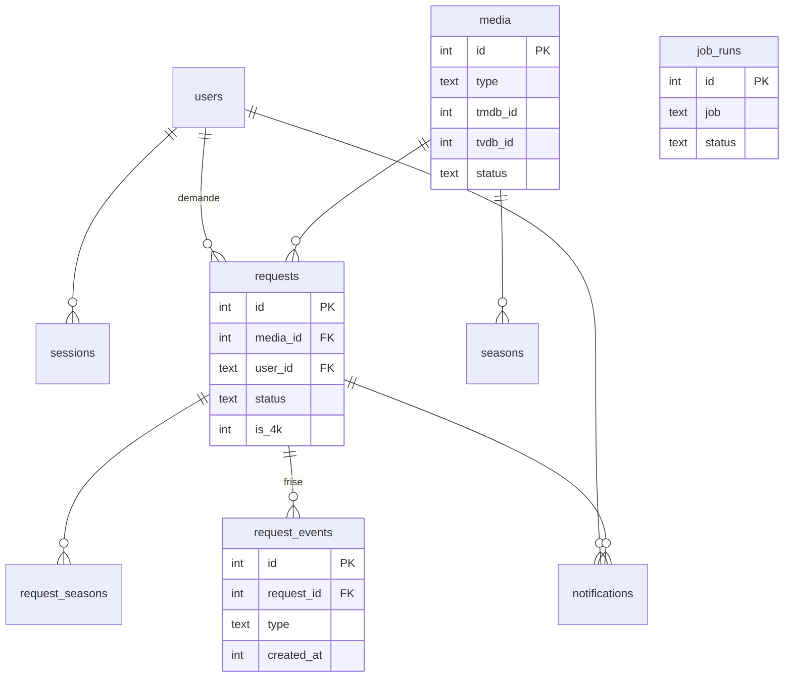

# Modèle de données

SQLite (better-sqlite3 + Drizzle, `casing: 'snake_case'`), un seul processus, WAL, quelques dizaines de membres, quelques milliers de médias. Pas de réglage serveur ni de partitionnement : des tables simples, des index justifiés par un écran ou un job.

## 1. Revue de l'existant (`settings`, `users`, `sessions`)

| Sévérité | Constat                                                                                                                                                                                                                             | Correctif                                                                                                                                                          |
| -------- | ----------------------------------------------------------------------------------------------------------------------------------------------------------------------------------------------------------------------------------- | ------------------------------------------------------------------------------------------------------------------------------------------------------------------ |
| Moyenne  | `sessions.user_id` sans index : `deleteAllForUser` et la cascade `ON DELETE` de `users` parcourent toute la table.                                                                                                                  | `CREATE INDEX sessions_user_id_idx ON sessions(user_id)`.                                                                                                          |
| Basse    | `purgeExpired` filtre `expires_at <= ?` sans index.                                                                                                                                                                                 | `sessions_expires_at_idx` (coût nul, purge en O(log n)).                                                                                                           |
| Moyenne  | `users.role` : l'enum Drizzle n'existe qu'en TypeScript, aucune contrainte en base.                                                                                                                                                 | `CHECK (role IN ('member','auto_approve','manager','owner'))` (règle à suivre pour tout enum : colonne `text` + `CHECK` généré depuis le tableau de `src/shared`). |
| Basse    | `users.quota_override` (JSON) validé par Zod à l'écriture seulement ; la lecture fait confiance à `$type<>`.                                                                                                                        | Repasser `quotaOverrideSchema.parse` à la lecture (comme `settings`), ou `CHECK (quota_override IS NULL OR json_valid(quota_override))`.                           |
| Basse    | PRAGMA `synchronous` absent (FULL par défaut en WAL : fsync à chaque commit).                                                                                                                                                       | `synchronous = NORMAL`, `journal_size_limit = 67108864` dans `openDb`.                                                                                             |
| Info     | Horodatages : `integer` en **secondes** (`mode: 'timestamp'`, `unixepoch()`). Bon choix, à garder partout ; ne pas mélanger avec `timestamp_ms`. Toute date de règle métier (quotas, purges) est calculée en secondes côté serveur. | Convention à respecter.                                                                                                                                            |
| Info     | `settings` : correct (clé/valeur, JSON validé par Zod à la lecture et à l'écriture, secrets chiffrés).                                                                                                                              | —                                                                                                                                                                  |

## 2. Tables restantes du MVP

Conventions : clés primaires `integer` auto-incrémentées pour les tables internes, `text` pour les ids externes (Emby). Clés étrangères toujours indexées. `created_at`/`updated_at` en secondes.

**`media`** — un titre connu de l'appli (vu sur une affiche, dans Emby, Radarr ou Sonarr, ou demandé).
`id` PK · `type` text `CHECK IN ('movie','tv')` · `tmdb_id` int NOT NULL · `tvdb_id` int · `radarr_id` int · `sonarr_id` int · `emby_item_id` text · `status` text `CHECK IN mediaStatuses`, **nullable** : `NULL` = absent (le cache retient aussi l'absence, sinon chaque affiche inconnue relancerait les appels) · `status_updated_at` · `seasons_computed_at` (dernier calcul des saisons d'une série, nullable) · `created_at`.
Index : `UNIQUE(tmdb_id, type)` (badge de chaque affiche : lecture par lot `WHERE (tmdb_id,type) IN …`), `tvdb_id` (webhooks Sonarr), `radarr_id`, `sonarr_id` (webhooks). Pas de titre ni d'affiche : TMDB reste la source (cache mémoire). `media_type` partagé dans `src/shared/media.ts`.

**`seasons`** — `id` PK · `media_id` FK → media `ON DELETE CASCADE` · `season_number` int · `status` text NOT NULL `CHECK IN mediaStatuses` (seules les saisons ayant un statut ont une ligne) · `UNIQUE(media_id, season_number)` (couvre aussi l'accès par média).

**`requests`** — `id` PK · `media_id` FK → media `ON DELETE RESTRICT` · `user_id` FK → users `ON DELETE CASCADE` · `status` text `CHECK IN requestStatuses` · `decided_by` FK → users `ON DELETE SET NULL` · `decline_reason` text · `quality_profile_id` int · `root_folder` text · `is_4k` int NOT NULL DEFAULT 0 (réservé, toujours 0) · `created_at` · `updated_at`.
Index : `(user_id, created_at)` (« Mes demandes » + quota), `(status, created_at)` (file d'approbation), `(media_id)`.

**`request_seasons`** — **table séparée**, pas de JSON : le quota compte des saisons, Sonarr reçoit une liste, la frise affiche l'état par saison. `request_id` FK `ON DELETE CASCADE` · `season_number` · PK `(request_id, season_number)`.

**`request_events`** — **table séparée** pour la frise (Demandée → Approuvée → Envoyée → Recherche → Dans Emby) : chaque étape a sa date, un acteur, éventuellement un message d'erreur (échec rejouable), et l'historique reste vrai après une relance. `id` PK · `request_id` FK `ON DELETE CASCADE` · `type` text `CHECK IN requestEventTypes` · `actor_id` FK users `SET NULL` · `detail` text · `created_at`. Index `(request_id, created_at)`. Ajout uniquement, jamais modifiée.

**`notifications`** — `id` PK · `user_id` FK `CASCADE` · `request_id` FK `SET NULL` · `kind` text `CHECK` · `read_at` · `created_at`. Index `(user_id, created_at DESC)` et partiel `(user_id) WHERE read_at IS NULL` (pastille non lus). Le texte est rendu à l'affichage depuis `kind` (pas de chaîne figée en base).

**`job_runs`** — `id` PK · `job` text · `status` `CHECK IN ('running','success','failed')` · `started_at` · `finished_at` · `detail`. Verrou : `CREATE UNIQUE INDEX job_runs_running ON job_runs(job) WHERE status = 'running'`. Démarrer un balayage = `INSERT` ; la violation d'unicité signifie « déjà en cours ». Au démarrage du serveur, passer en `failed` les lignes `running` orphelines (crash). Index `(job, started_at)` pour « dernier balayage » (SQLite le parcourt à rebours pour `ORDER BY started_at DESC`). Fait en 3.2 : `services/jobs.ts` (`startJob` → `null` si déjà en cours, `finishJob`, `failOrphanJobs` appelé par `buildApp`).

**Webhooks** : pas de table. Les webhooks Radarr/Sonarr ne font que déclencher un recalcul idempotent du statut (`media.status` dérivé de l'état courant) ; un doublon recalcule la même valeur. Les `request_events` ne sont ajoutés que si le statut change.

### Quota

```sql
-- films
SELECT count(*) FROM requests r JOIN media m ON m.id = r.media_id
WHERE r.user_id = ? AND m.type = 'movie' AND r.status NOT IN ('declined','cancelled') AND r.created_at >= ?;
-- saisons
SELECT count(*) FROM request_seasons s JOIN requests r ON r.id = s.request_id
WHERE r.user_id = ? AND r.status NOT IN ('declined','cancelled') AND r.created_at >= ?;
```

Servies par `requests(user_id, created_at)`. Vérification et insertion dans **la même transaction** (`db.transaction`, synchrone avec better-sqlite3 : aucune course possible dans un seul processus).

### Double clic

`CREATE UNIQUE INDEX requests_active ON requests(media_id, user_id, is_4k) WHERE status IN ('pending','approved','sent')` : un second POST identique ne crée rien : insertion via `onConflictDoNothing({ target, targetWhere })` de Drizzle, puis lecture de la demande active existante, renvoyée en 200 (pas 409). Pour les séries, le service refuse en plus les saisons déjà couvertes par une demande active.

### 4K plus tard

Seule la colonne `requests.is_4k` (et sa présence dans l'index ci-dessus) est posée. Le jour venu : `media.status_4k`, `radarr_4k_id`/`sonarr_4k_id`, réglages d'un second serveur. Rien d'autre maintenant.

## 3. Statuts : une seule source

- `src/shared/status.ts` est l'unique définition : `mediaStatuses` (existant), à compléter de `requestStatuses` (`pending`, `approved`, `declined`, `cancelled`, `sent`, `failed`, `available`) — l'annulation par le membre passe la demande en `cancelled` (historique conservé, hors quota, hors `requests_active`) et `requestEventTypes` (valeurs à fixer en 4.1/4.2 ; `requestStatuses` posé en 3.2). Les `CHECK` SQL et les schémas Zod en dérivent.
- **Stockés** : `requests.status` (cycle de vie piloté par l'appli), `request_events` (faits), `media.status` et `seasons.status` (**cache** calculé par le serveur à partir d'Emby + Radarr/Sonarr + demandes).
- **Dérivés, jamais stockés** : étape courante de la frise (dernier évènement), compteurs de quota, nombre de non lus, progression d'un téléchargement (lue dans la file Radarr/Sonarr, en cache mémoire 30 s). `partial` est calculé depuis les saisons mais **gardé dans `media.status`** (cache) : une page d'affiches se lit en une requête, sans agrégat.
- **3.2** : `media.status` ne garde que la part bibliothèque (`available`, `partial`, `downloading`, `NULL`). Le statut affiché = `displayStatus(bibliothèque, demande)` (`services/availability.ts`), seule fusion ; la part demande (4.1) y sera branchée sans toucher au calcul. Durée de vie du cache : 5 min (1 min en téléchargement) ; le balayage complet viendra en 5.1.
- Une seule fonction serveur calcule le statut d'un média ; webhooks, balayages et création de demande l'appellent.

## 4. Migrations et exploitation

- Migrations : `drizzle-kit generate` uniquement, une par tâche, nom parlant (`0002_media_demandes.sql`), jamais modifiée une fois fusionnée ; appliquées au démarrage par `migrate()`. Vérifier le SQL généré (les `CHECK` et index partiels s'écrivent dans le schéma via `check()` / `.where()`).
- Attention, recréation de table : ajouter un `CHECK` à une table existante (ex. `users.role`) fait recréer la table par drizzle-kit. `migrate()` s'exécute en transaction, où `PRAGMA foreign_keys=OFF` est sans effet : le `DROP TABLE users` supprime en cascade toutes les `sessions`. Accepté pour la tâche 1.7 (avant toute mise en production : simple déconnexion) ; après la mise en production, éditer la migration à la main pour préserver les données.
- PRAGMA dans `openDb` : `journal_mode = WAL`, `foreign_keys = ON`, `busy_timeout = 5000` (déjà là), plus `synchronous = NORMAL` et `journal_size_limit`. `PRAGMA optimize` à la fermeture.
- Sauvegarde : ne **pas** copier `request.db` seul pendant que le serveur tourne (le `-wal` contient les dernières écritures). Utiliser `sqlite.backup(path)` (API de sauvegarde de better-sqlite3, à chaud) ou `VACUUM INTO '/data/backups/…'` dans un job quotidien, en gardant 7 copies. Sauvegarder aussi `secret.key`, sans quoi les secrets sont illisibles.
- Purges (job quotidien, enregistré dans `job_runs`) : sessions expirées ; notifications lues de plus de 90 jours ; `job_runs` de plus de 30 jours. Les demandes et leurs évènements sont conservés.



## 5. Tâches, par priorité

1. **Fait (tâche 1.7, correctif socle)** — index `sessions(user_id)` et `sessions(expires_at)`, `CHECK` sur `users.role` et `json_valid` sur `quota_override` (relu avec `quotaOverrideSchema`), `users.last_login_at` nullable, PRAGMA `synchronous`/`journal_size_limit`. _Critères_ : migration générée ; `EXPLAIN QUERY PLAN` des deux requêtes de `sessions.ts` utilise l'index ; un `INSERT` avec un rôle inconnu échoue.
2. **Fait (3.2)** — `media`, `seasons`, `job_runs`, `requestStatuses` dans `status.ts`, fonction unique de calcul du statut. _Critères_ : tests absent / partiel / disponible / en téléchargement ; lecture par lot des statuts d'une page d'affiches en une requête.
3. **4.1** — `requests`, `request_seasons`, `request_events`, index `requests_active`. _Critères_ : quota testé en bord de fenêtre ; deux POST identiques → une seule ligne ; quota dépassé → rien d'inséré (transaction).
4. **4.2** — évènements `approved`/`declined`/`sent`/`failed`, relance d'un échec. _Critères_ : la frise se reconstruit depuis `request_events` ; une relance ajoute un évènement sans en effacer.
5. **5.1** — `job_runs` + verrou partiel, recalcul idempotent sur webhook, sauvegarde et purges planifiées. _Critères_ : deux balayages simultanés → un seul démarre ; webhook rejoué → aucun évènement en double ; sauvegarde restaurable testée. Le balayage complet purge aussi les lignes `media` sans statut, sans demande et sans accès récent (par exemple plus de 30 jours) : les titres vus sur une affiche s'accumulent sinon.
6. **5.2** — `notifications`. _Critères_ : compteur non lus via l'index partiel ; texte du message testé par `kind`.
